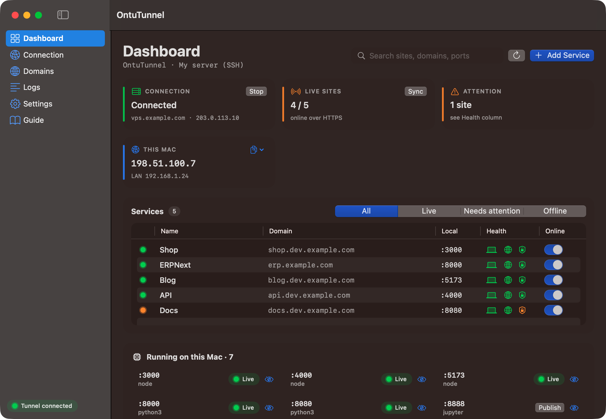
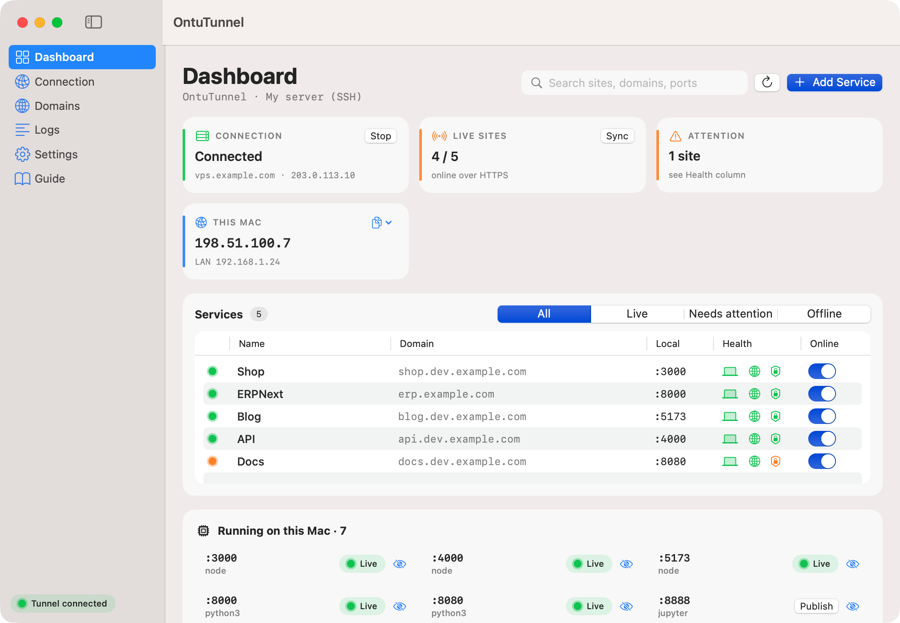
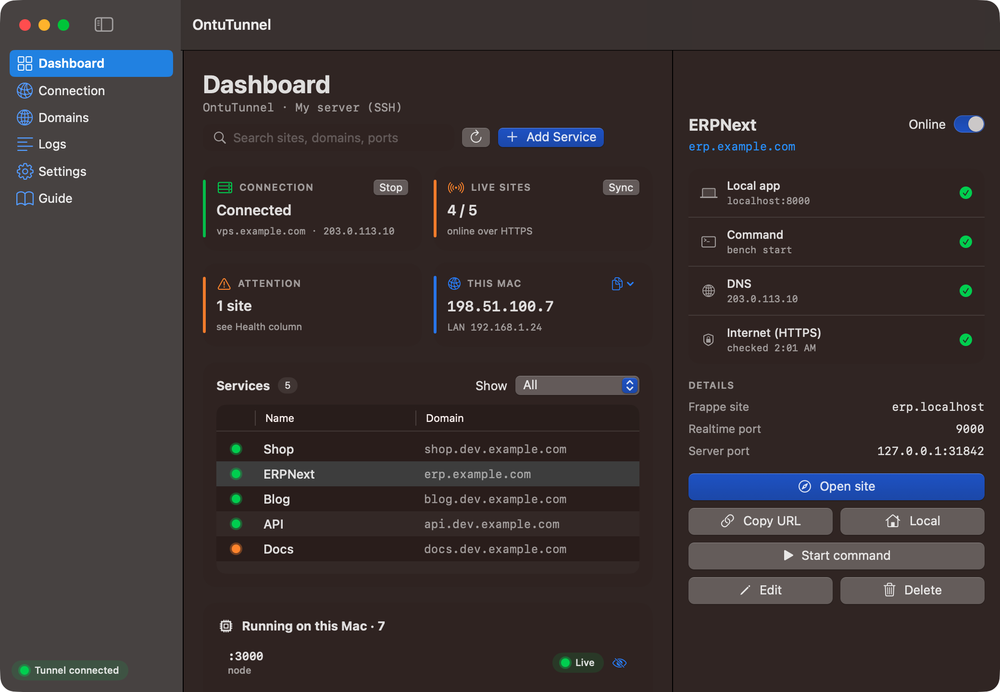
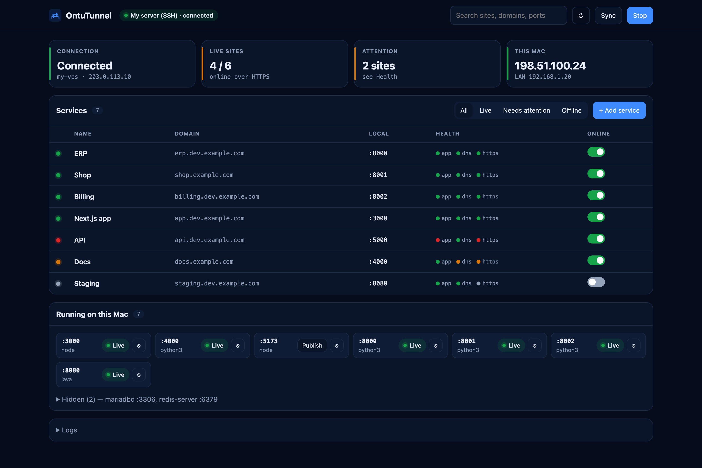
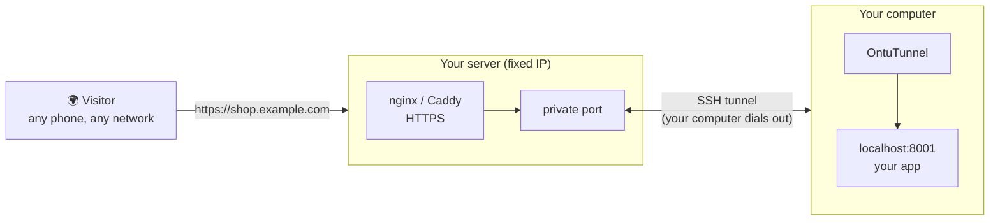
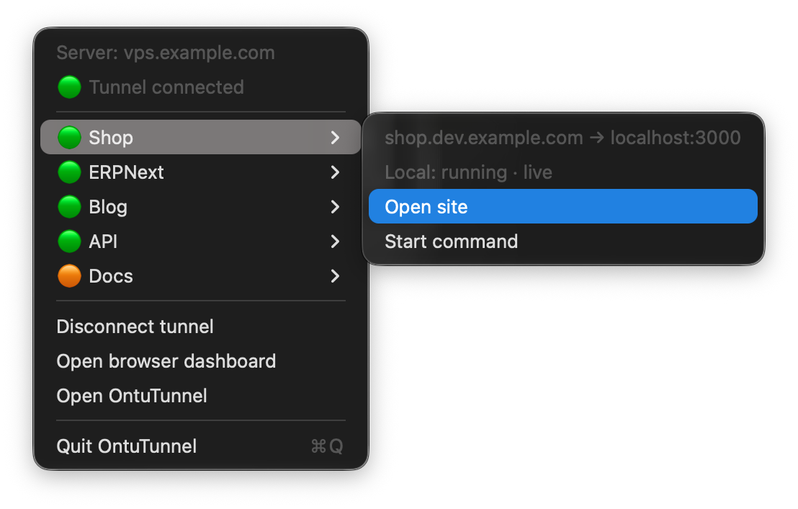

<div align="center">


# OntuTunnel

**Put the app running on your computer on your own domain, with HTTPS, in a few clicks.**

Your app runs at `localhost:3000`. OntuTunnel makes it open at `https://shop.example.com`
from any phone or network in the world. No router setup, no monthly tunnel bill.

[](#install)
[](https://github.com/itsfaiyaz/OntuTunnel/actions/workflows/build.yml)
[](LICENSE)



</div>

---

## Why OntuTunnel?

You built something on your laptop and want to show it to a client, a teammate or your own phone,
on **your own domain** with a real HTTPS lock.

| | Router port forwarding | ngrok-style services | **OntuTunnel** |
|---|---|---|---|
| Your own domain | Only with a static IP | Paid plans | ✅ |
| Works on any Wi-Fi / mobile network | ❌ | ✅ | ✅ |
| HTTPS | Do it yourself | ✅ | ✅ Automatic |
| Many sites at once | Manual | Paid | ✅ Unlimited |
| Cost | Static IP fee | Monthly | **Free, open source** |

## Features

- 🌍 **Three ways to go live**: your own server, your static IP, or a free Cloudflare Tunnel.
- 🔒 **HTTPS done for you**: certificates are created and renewed automatically.
- ✳️ **Wildcard domains**: add one DNS record for `*.dev.example.com`, and every new site under it works at once.
- 🧭 **Sees what's running**: lists the ports open on your computer. Click **Publish** to put one online.
- 🟢 **Health at a glance**: for every site it checks the app, DNS and HTTPS, from the internet's side.
- 📶 **Survives network changes**: switch Wi-Fi, use a hotspot or get a new IP, and it reconnects in seconds.
- 👥 **One server, many computers**: your laptop, your desktop and your team can all publish sites through the same server. Each one only touches its own sites.
- 🔔 **Update notice**: tells you when a new version is out, with a Download button.
- 🔐 **Private dashboard**: other websites open in your browser can't use it, and everything sent to the server is checked first.
- 🔑 **Easy SSH keys**: see the keys on your computer, or create one with a user name; step-by-step for Google Cloud and other servers.
- 📝 **Hosts file editor**: see, add, change and delete entries from the app (Mac, Windows, Linux).
- ✅ **First-time HTTPS checklist** for *My static IP*: ports, firewall, DNS, router and a test from the internet.
- ☕ **Keep awake** (optional): stops the computer from sleeping while your sites are online.
- 🧭 **Menu bar on Mac**: see every site's status and connect, open sites or start their apps without opening the window.
- 🖥️ **Desktop apps**: a native Mac app (menu bar) and a Windows app (tray icon next to the clock). The same dashboard also opens in any browser at `http://localhost:7777`. Light, dark or system theme.
- 🛡️ **Safe on servers you already use**: it only adds its own files and never edits yours (see [below](#what-it-changes-on-your-server)).
- 🧩 **Frappe / ERPNext ready**: site name per domain, realtime (Socket.IO) port supported.

## Screenshots

| Light mode | Site details |
|---|---|
|  |  |

<p align="center"><sub>Click a site to see its health, its settings and quick actions.</sub></p>

<details>
<summary>Windows & Linux: the same dashboard (Windows app window, Linux browser)</summary>
<p align="center"></p>
</details>

## How it works



Your domain points to the **server**, not to your computer. Your computer **dials out** to the server and
keeps the line open. So your home IP, router or Wi-Fi doesn't matter. With **Cloudflare Tunnel**,
Cloudflare plays the server's part, for free.

## Pick a way to go live

| Mode | You need | Cost | DNS |
|---|---|---|---|
| **My server (SSH)** | Any VPS or cloud VM with a fixed IP | Your server bill | `A` record → server IP |
| **My static IP** | A static IP from your internet provider, and ports 80/443 open | Provider's fee | `A` record → your IP |
| **Cloudflare Tunnel** | A free Cloudflare account with your domain | **Free** | Set up for you |

## Install

Download the file for your system from **[Releases](../../releases)**.

| System | File | Notes |
|---|---|---|
| **macOS 14+** (Apple Silicon & Intel) | `OntuTunnel-x.y.z.dmg` | Drag to Applications. First open: **System Settings → Privacy & Security → Open Anyway**. |
| **Windows 10/11** (x64, ARM64) | `OntuTunnel-Setup-x.y.z-x64.exe` or the portable `.zip` | If SmartScreen warns: **More info → Run anyway**. |
| **Debian / Ubuntu** | `ontutunnel_x.y.z_amd64.deb` | `sudo apt install ./ontutunnel_*.deb` |
| **Fedora / RHEL** | `ontutunnel-x.y.z.x86_64.rpm` | `sudo dnf install ./ontutunnel-*.rpm` |
| **Any Linux** | `.tar.gz` | Unpack and run `./ontutunnel` |

On **Windows**, OntuTunnel opens as its own app window and keeps running in the tray (next to the clock) when you close it.
On **Linux**, the dashboard opens in your browser at **http://localhost:7777**.
In *My static IP* mode, OntuTunnel also adds your sites to this computer's hosts file, so they open here even when the router can't reach its own public IP.
Cloudflare mode also needs [cloudflared](https://developers.cloudflare.com/cloudflare-one/connections/connect-networks/downloads/).

<details>
<summary>Linux extras · build from source</summary>

```bash
# start after login
systemctl --user enable --now ontutunnel
# "My static IP" mode: allow ports 80/443 once
sudo setcap cap_net_bind_service=+ep /usr/bin/ontutunnel
```

```bash
git clone https://github.com/itsfaiyaz/OntuTunnel.git && cd OntuTunnel
./scripts/build-app.sh --install   # macOS app (Xcode 15+)
./scripts/make-dmg.sh              # macOS DMG
./scripts/build-cross.sh           # Windows + Linux (Go 1.27+)
```

The Mac app is Swift with no extra libraries. The Windows/Linux version lives in [`cross/`](cross) (Go, one file to run).
Every push is built by [GitHub Actions](.github/workflows/build.yml).
</details>

## Quick start

1. **Connection**: choose a mode and follow the steps. Each step shows ✓, or tells you what to fix.
2. **Dashboard**: click **Publish** next to your app's port (or **Add Service**).
3. **Domain**: type a name under your wildcard (`shop` → `shop.dev.example.com`), or use any domain and add the `A` record it shows.
4. Wait for **app · dns · https** to turn green. Done. Open it from anywhere.

**Day to day on a Mac, use the menu bar icon.** It shows:
- the server and whether the tunnel is connected
- every site with a 🟢 / 🟠 / 🔴 dot. Point at a site to open it, or start or stop its app.
- Connect / Disconnect tunnel, Open browser dashboard, Open OntuTunnel

Closing the window keeps OntuTunnel running in the menu bar, so your sites stay online.

<p align="center"></p>

**Tip: set up a wildcard once.** In **Domains**, add `dev.example.com`, then add one DNS record:
`A`  `*.dev` → your server IP. Every new `something.dev.example.com` now works without touching DNS.

## What it changes on your server

Only its own things. Nothing you already run is edited.

| Your server has | OntuTunnel adds |
|---|---|
| Nothing on ports 80/443 | Its own Caddy web server with automatic HTTPS, one file per site in `/etc/ontutunnel/sites/` |
| nginx with other sites | One `ontutunnel-<domain>.conf` per site. Checked with `nginx -t` first, undone if anything fails |
| Something else on 80/443 | Nothing. It stops and tells you |

Tunnel ports are random and private (`127.0.0.1` only).

**Several computers on one server:** each computer only writes and removes its own sites. Ports another computer uses are never taken, even when it is switched off. A domain another computer already serves is refused, with a clear message. **Remove OntuTunnel from server** deletes only this computer's sites; the shared parts go when the last computer leaves.

## FAQ

**Is it free?** Yes, MIT licensed. Cloudflare mode needs nothing else. Server mode only costs your own server.

**Does my traffic pass through someone else?** No. Only through what you pick: your server, your IP, or your Cloudflare account.

**I changed Wi-Fi / my IP changed. Does it still work?** Yes. It notices the change and reconnects within seconds. Only *My static IP* mode is tied to one network.

**What if my computer sleeps?** A sleeping computer can't serve sites. Turn on **Settings → Keep this computer awake**. The screen can still turn off. Closing a laptop lid usually still sleeps it.

**Can two computers use the same server?** Yes. Set up the same server on each computer; every computer publishes its own sites without touching the others.

**Can I control it from my phone?** Yes. In Settings, allow other devices on your Wi-Fi and open the link with the access key.

## Roadmap

- [x] macOS, Windows and Linux apps
- [x] Server, static IP and Cloudflare modes, wildcard domains, browser dashboard
- [ ] Automatic DNS records through provider APIs (Cloudflare, Hostinger, GoDaddy)
- [ ] Password protection per site
- [ ] Notarized macOS build

## Contributing

Issues and pull requests are welcome. For bigger changes, please open an issue first.

## License

[MIT](LICENSE) © Md Faiyaz Ansari ([@itsfaiyaz](https://github.com/itsfaiyaz)) · Made by **[Ontu Technologies](https://ontu.in)**

<div align="center">

If OntuTunnel helps you, please **⭐ star the repo**. It helps others find it.

</div>
