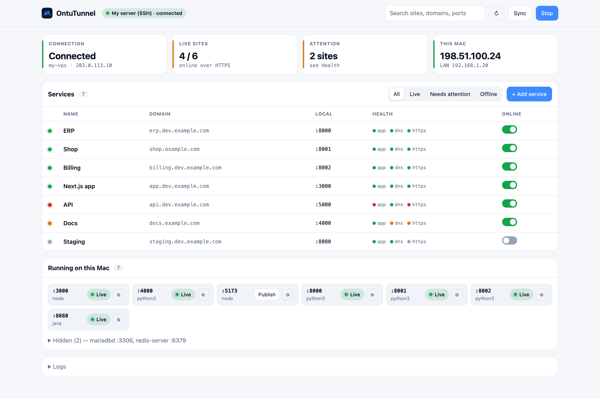
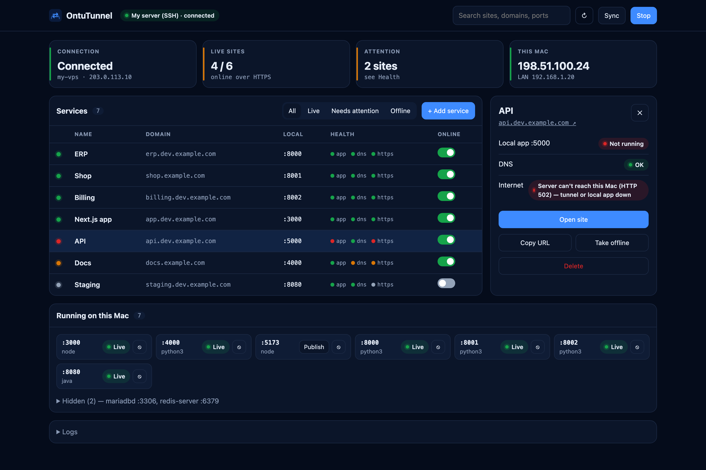
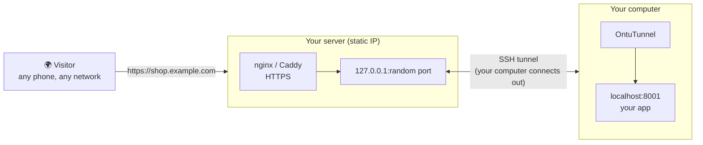

<div align="center">


# OntuTunnel

**Your localhost, live on your own domain — with HTTPS, in a few clicks.**

Put any app running on your computer (`localhost:8000`, `:3000`, `:5173` …) on a real domain like
`https://shop.example.com` — reachable from any phone or network in the world.
No port forwarding, no static IP at home, no monthly tunnel subscription.

[](#install)
[](#roadmap)
[](LICENSE)
[](Package.swift)


</div>

---

## Why OntuTunnel?

You built something on your laptop and want to show it — to a client, on your phone, to a teammate —
on **your own domain**, with a real certificate. The usual options are painful:

| | Port forwarding | ngrok-style services | **OntuTunnel** |
|---|---|---|---|
| Your own domain | Only with a static IP | Paid plans | ✅ Always |
| Works behind CGNAT / any Wi-Fi | ❌ | ✅ | ✅ |
| HTTPS certificate | Do it yourself | ✅ | ✅ Automatic (Let's Encrypt / Cloudflare) |
| Many sites at once | Manual | Paid | ✅ Unlimited |
| One DNS record for every new site | ❌ | ❌ | ✅ Wildcard domains |
| Your data stays on your infrastructure | ✅ | ❌ | ✅ |
| Cost | Router + static IP | Monthly | **Free & open source** |

## Features

- 🌍 **Three ways to go live** — pick what you have:
  - **Your own server (SSH)** — any VPS / cloud VM with a static IP. OntuTunnel logs in, sets everything up, and keeps a tunnel open from your computer.
  - **Your static IP** — no server at all; your computer serves the sites itself on 80/443.
  - **Cloudflare Tunnel** — **completely free, nothing else needed**: no server, no static IP, no router change.
- 🔒 **Automatic HTTPS** — Let's Encrypt certificates issued and renewed for you (or Cloudflare's edge).
- ✳️ **Wildcard domains** — add `*.dev.example.com` once; every new service (`app.dev.example.com`, `shop.dev.example.com`…) is live instantly, no DNS step.
- 🧭 **Sees what's running** — lists the ports open on your machine; click **Publish** to put one online. Hide databases and caches you never publish.
- 🟢 **Live health for every site** — local app · DNS · HTTPS, checked end-to-end from the internet's point of view.
- 🖥️ **Native macOS app + browser dashboard** — menu-bar status, plus the same dashboard at `http://localhost:7777` (optionally from your phone with an access key).
- 🛡️ **Safe on servers you already use** — if nginx is already running other sites, OntuTunnel only adds its own `ontutunnel-<domain>.conf` files, tests the config before every reload, rolls back on error, and uses random free ports bound to `127.0.0.1`. One click removes everything it added.
- ⚙️ **Start commands with keep-alive** — let OntuTunnel start your dev server (`npm run dev`, `bench start`, …) and restart it if it crashes.
- 🧩 **Frappe / ERPNext aware** — pass the site name per service (`X-Frappe-Site-Name`), realtime (Socket.IO) port supported.

## Screenshots

| Dark | Light |
|---|---|
|  |  |

<p align="center"><br><sub>Click any site for its full health, the DNS record it needs, and quick actions.</sub></p>

## How it works



Because **your computer opens the connection**, it works on any Wi-Fi, behind any router or carrier-grade NAT.
With **Cloudflare Tunnel** the server box is Cloudflare's edge — free.

## Choose your way to go live

| Mode | You need | Cost | DNS |
|---|---|---|---|
| **My server (SSH)** | A VPS / Google Cloud / AWS VM with a static IP | Server bill | `A` record → server IP (or one wildcard) |
| **My static IP** | A static public IPv4 from your ISP + port forwarding 80/443 | ISP add-on | `A` record → your static IP |
| **Cloudflare Tunnel** | A free Cloudflare account with your domain on it | **Free** | Automatic |

## Install

### macOS (14 Sonoma or newer · Apple Silicon & Intel)

1. Download `OntuTunnel-x.y.z.dmg` from **[Releases](../../releases)**.
2. Drag **OntuTunnel** into **Applications** and open it.
3. First launch only: macOS may say it can't verify the developer → **System Settings → Privacy & Security → Open Anyway**.

### Build from source

```bash
git clone https://github.com/itsfaiyaz/OntuTunnel.git
cd OntuTunnel
./scripts/build-app.sh --install     # builds and copies OntuTunnel.app to /Applications
./scripts/make-dmg.sh                # universal DMG in dist/
```

Requires Xcode 15+ (Swift 5.9). No third-party dependencies.

## Quick start

1. **Connection** → choose **My server**, **My static IP** or **Cloudflare Tunnel** and follow the steps shown in the app (each step shows ✓ or what to fix).
2. **Dashboard** → in *Running on this Mac*, click **Publish** next to your app's port — or **Add Service**.
3. Enter a domain:
   - under your **wildcard** (e.g. `shop` → `shop.dev.example.com`) — live immediately, or
   - any **custom domain** — add the `A` record OntuTunnel shows you.
4. Watch the row turn green: **app · dns · https**. Done — open it from anywhere.

### One-time wildcard setup (recommended)

**Domains** → add `dev.example.com`, then create a single DNS record:

| Type | Name | Value |
|---|---|---|
| `A` | `*.dev` | your server or static IP |

Every service named `something.dev.example.com` now goes live with HTTPS without touching DNS again.

## What OntuTunnel changes on your server

Only things it owns — nothing you already run is edited:

| Server already has | OntuTunnel adds |
|---|---|
| Nothing on 80/443 | Its own Caddy (`/opt/ontutunnel`, service `ontutunnel-caddy`) with automatic HTTPS |
| nginx with other sites | `/etc/nginx/conf.d/ontutunnel-<domain>.conf` per site (tested with `nginx -t`, rolled back on failure) + certbot certificates |
| Something else on 80/443 | Nothing — it stops and tells you |

Tunnel ports are random, unused, and bound to the server's `127.0.0.1` only.
**Connection → Remove OntuTunnel from server** deletes everything it added.

## Browser dashboard

While the app runs, open **http://localhost:7777**. Turn on *Allow other devices on my Wi-Fi* in Settings to
control it from your phone — every request then needs the access key shown in the app.

## Roadmap

- [x] macOS app — SSH relay, static IP, Cloudflare Tunnel, wildcard domains, browser dashboard
- [ ] **Windows** app (installer)
- [ ] **Linux** app (AppImage / .deb)
- [ ] Automatic DNS updates via provider APIs (Cloudflare, Hostinger, GoDaddy)
- [ ] Basic-auth protection per site
- [ ] Notarized macOS build

## FAQ

**Is it really free?** Yes — OntuTunnel is MIT-licensed. With Cloudflare Tunnel you need nothing else; with your own server you only pay for the server you already have.

**Does my traffic go through anyone else's servers?** Only through infrastructure you choose: your own server, your own IP, or your Cloudflare account.

**Can I run several sites at once?** Yes, as many as you like — each gets its own domain and certificate.

**What if my computer sleeps?** Sites are served from your computer, so keep it awake while they need to be online. OntuTunnel reconnects automatically after sleep or network changes.

## Contributing

Issues and pull requests are welcome. For larger changes, please open an issue first to discuss what you'd like to change.

## License

[MIT](LICENSE) © Md Faiyaz Ansari ([@itsfaiyaz](https://github.com/itsfaiyaz))

<div align="center">

If OntuTunnel saves you time, please **⭐ star the repo** — it helps others find it.

</div>
